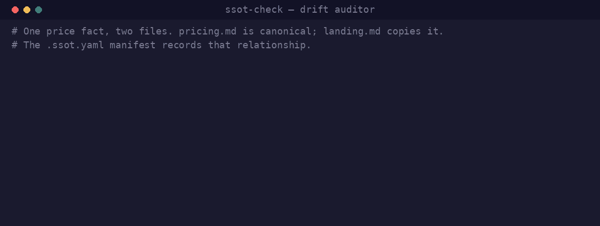

# ssot-check

**Single-source-of-truth drift auditor for documentation-heavy repos.**

<p align="center">
  
</p>

A deterministic, dependency-free CLI (plus a skill wrapper, a pre-commit hook,
and a GitHub Action) that catches facts hand-copied across files and gone stale.

## The problem

Docs repeat facts. A price lives in `pricing.md`, then gets hand-copied into a
media kit, a landing page, and a README. Someone updates the price in one place.
The copies drift — and nobody notices until a customer does.

`ssot-check` records where each fact's canonical value lives in a `.ssot.yaml`
manifest, then verifies every copy against it on each run. One canonical,
everything else is a copy. Drift is reported with exact `file:line` locations and
a proposed value — never a silent edit.

It is deterministic: values are extracted with one-capture-group regexes and
compared exactly (after typed normalization). There is no fuzzy matching — a
mismatch always means something is wrong.

Copies you know about are half the problem. The other half is the copy nobody
declared, and the old value a partial update left behind. A fact's optional
[`guard`](#guards-superseded-and-restated-values) scans the repo's prose for
both. [Named repos](#named-repos) let one manifest check copies in other
repositories without hardcoding where they are cloned.

## Quickstart

```bash
# 1. DISCOVER — scan prose for drift-prone facts (read-only; writes nothing).
python3 ssot_check.py discover --root .

# 2. CURATE — turn the proposals into a manifest by hand (see the reference
#    below and .ssot.example.yaml). Assign one canonical per fact.
cp .ssot.example.yaml .ssot.yaml   # then edit

# 3. CHECK — verify every copy matches its canonical.
python3 ssot_check.py check
```

`check` exits `0` when everything is in sync, `1` when drift or staleness is
found, and `2` on a manifest/config error — ready for a pre-commit hook or CI.

No installation and no dependencies: it is a single stdlib-only file. Python 3.9+.

## CLI reference

```
python3 ssot_check.py <command> [options]

  check      (default) verify copies against canonicals
  validate   structural check of the manifest against the schema
  discover   propose drift-prone facts from prose (writes nothing)
  explain    show one fact's canonical value and all copies
  fix        rewrite drifted local copies from the canonical (diff; --write applies)
  pointers   check that every pointer marker's target file exists
```

Common options (`check`, `validate`, `explain`):

| Option | Meaning |
|--------|---------|
| `-f, --manifest PATH` | Manifest path (default `.ssot.yaml`). |
| `--root DIR` | Repo root for relative paths (default: the manifest's directory). |
| `--json` | Machine-readable output (`check`, `discover`, `explain`). |
| `--fetch` | For cross-repo copies, run `git fetch` in the sibling repo and compare against its remote-tracking ref. Makes a network call and updates that repo's remote-tracking refs and `FETCH_HEAD`; never pulls, rebases, or touches its working tree. Off by default. `check`/`explain`. |
| `--repo NAME=PATH` | Where a [named repo](#named-repos) is checked out on this machine. Repeatable. `check`/`explain`. |

`discover` takes `--root DIR`, repeatable `--ignore GLOB`, and `--json`. With
`--manifest PATH --untracked-only`, it suppresses occurrences already covered
by the curated manifest and reports only candidate copies the manifest does not
know about. `--github-annotations` renders those candidates as advisory GitHub
Actions warnings, and requires `--untracked-only` because its message asserts
that an occurrence is untracked. `--json` takes precedence over it. Running
`ssot_check.py` with no subcommand defaults to `check`.

Like `check` and `explain`, `--root` defaults to the manifest's directory (`.`
when there is no manifest), so a manifest's relative paths resolve the same way
in every subcommand. Coverage is first-match-per-locator: when a manifest
pattern matches a file more than once, only the first match counts as covered
and `check` reports the pattern as ambiguous. `--untracked-only` output filters
`proposals` and `drift`; `files_scanned` and `discarded` still describe the full
scan.

Discovery *findings* are heuristic and never fail the command — uncovered
candidates always exit `0`, and only deterministic `check` results should gate a
build. `discover` itself exits `2` on a configuration error.

Exit codes (`check`): `0` in sync · `1` drift, canonical moved, stale entry,
unverified copy, stale-past-freshness canonical, repo not found, stale value,
or restated value · `2` manifest missing, unparseable, or schema-invalid, or a
malformed `--repo`.

Exit codes (`discover`): `0` always, including when candidates are reported ·
`2` an explicitly passed `--manifest` that is missing, unparseable, or
schema-invalid, `--untracked-only` without a valid manifest, or
`--github-annotations` without `--untracked-only`.

Discovery omits the conventional loopback address `127.0.0.1` from version
proposals. An explicit `v127.0.0.1` or a same-line `Version:`, `Release:` or
`Build:` label immediately before it keeps that value discoverable. Other
four-part versions remain candidates. This heuristic does not affect explicit
manifest checks, including checks for copied addresses.

### Statuses in a check report

- **IN SYNC** — copy matches canonical.
- **DRIFTED** — copy no longer matches; shows canonical value, copy value, and
  `file:line`. A `(canonical suspect)` tag appears when a `monotonic` fact's copy
  is numerically higher than its canonical (the canonical is probably the stale
  side — confirm before regressing the copy).
- **CANONICAL MOVED** — the canonical pattern no longer matches its file. The
  manifest is stale.
- **STALE MANIFEST ENTRY** — a copy pattern no longer matches (reworded/removed).
- **UNVERIFIED** — a cross-repo copy could not be read.
- **STALE CANONICAL (freshness)** — the canonical file has not been edited within
  `max_age_days`.
- **REPO NOT FOUND** — a [named repo](#named-repos) is not checked out anywhere
  the run looked. Lists every location tried.
- **STALE VALUE** — a [guard](#guards-superseded-and-restated-values) found a
  `superseded` value still asserted.
- **RESTATED** — a guard with `restated: true` found the current value outside
  the canonical and its declared copies.

## Manifest reference

`.ssot.yaml` lives at the repo root. Annotated template: [`.ssot.example.yaml`](.ssot.example.yaml).
Formal schema for editors/CI: [`schema/ssot.schema.json`](schema/ssot.schema.json).
A key the schema does not define is a validation error (exit `2`), so a
misspelling such as `gaurd:` or `relaton:` cannot silently turn off what it
was meant to enable.

```yaml
# Globs excluded from globbed-copy expansion and from `discover` scans.
ignore_paths:
  - "vendor/**"

facts:
  - name: user-count            # kebab-case identifier (required)
    type: integer               # string|integer|currency|semver|date (default: string)
    note: >                     # optional: what it is, cadence, counting convention
      Active users, excluding trial accounts.
    monotonic: true             # optional: flag "canonical suspect" if a copy is higher
    freshness:                  # optional: warn when the canonical file goes stale
      owner: growth-team
      max_age_days: 30
    canonical:                  # where the true value lives (required)
      file: docs/metrics.md
      pattern: 'Active users:\s*([\d,]+)'   # regex, EXACTLY one capture group
    copies:                     # every other place the value is written (required, >=1)
      - file: README.md
        pattern: '([\d,]+) users trust'
      - file: marketing/site.html
        pattern: 'data-stat="users">([\d,]+)\+?<'
        rounding: floor-1000    # optional per-copy transform (see below)
        note: auto-written by scripts/metrics.py
```

### Fields

- **`name`** (required) — short kebab-case identifier.
- **`type`** — normalization applied before comparison:
  - `string` (default): literal. Strips surrounding whitespace and a single
    trailing `+`; nothing else. `1,234` ≠ `1234` under `string` — use `integer`.
  - `integer`: strips thousands separators (`,` `_` whitespace) and a trailing
    `+`, compares numerically. `1,234` == `1234` == `1234+`.
  - `currency`: strips a leading currency symbol (`$ € £ ¥`), separators, and a
    trailing `+`; compares numerically (decimals allowed). Does **not** expand
    magnitude suffixes — `$5k` is not a currency amount; keep it `string`.
  - `semver`: ignores a leading `v`. `v1.2.3` == `1.2.3`.
  - `date`: parses common formats (`2026-07-13`, `07/13/2026`, `July 13, 2026`,
    …) to a calendar date and compares.
- **`monotonic`** — for counts that only grow. If a copy is numerically higher
  than the canonical, the drift is tagged `canonical suspect`.
- **`freshness`** `{owner, max_age_days}` — checks the canonical file's git
  last-edit date (`git log -1 --format=%cs`). Older than `max_age_days` →
  reported (and exits `1`). Skipped with a note when not in a git repo.
- **`canonical`** (required) — `{file, pattern}`. The true value and how to
  extract it.
- **`copies`** (required, ≥1, unless the fact has a `guard`) — every other
  `{file, pattern}` or `{file, json}`. Optional per copy:
  - **`note`** — free text.
  - **`rounding`** — a deterministic transform applied to the *canonical* value
    before an exact compare, for copies a script intentionally rounds:
    `floor-10`, `floor-100`, `floor-1000` (floor to that multiple), or
    `floor-1000-as-K` (floor to thousands; compare against a value written as
    `NNN`, e.g. canonical `156703` matches copy `156`). Not fuzzy — a mismatch
    still means something is wrong (usually sync lag).
  - **`relation: floor`** — the copy is a reader-facing floor (`80+ episodes`,
    `13K+ followers`), not the exact value. See [floors](#floors).
  - **`max_gap_pct`** — with `relation: floor`, how far below the canonical
    the floor may trail before it is reported.

### Patterns

- Exactly **one capture group** per pattern (`validate` enforces this). The check
  compares captured strings, not whole lines.
- Patterns match against the **whole file content**, not line by line — so a
  value and its label on different lines can be matched by anchoring on a stable
  attribute and letting `\s*` cross the break. If a pattern matches more than
  once, the first match is used and a warning is emitted.
- Put regexes in **single-quoted** YAML strings so backslashes survive.

### JSON locators

A canonical or copy in a JSON file can name a key path instead of a regex:

```yaml
facts:
  - name: episode-count
    type: integer
    canonical:
      file: docs/data.json
      json: episodes_published        # a scalar value
    copies:
      - file: docs/episodes.json
        json: episodes.#              # '#' = length of the list or object
      - file: README.md
        pattern: 'Total Episodes:\*\* (\d+)'
```

The path is dot-separated keys and list indexes (`stats.platforms.0.views`).
A final `#` reads the length of the list or object before it. The value must
be a string, number or boolean; a path that ends on a list or object is an
error unless it ends in `#`. A missing key reports the segment where the path
stopped. Give `json` or `pattern`, not both. The reported line is approximate:
where the last named key first appears in the file. Discovery does not read
JSON files.

### Floors

Promotional copy rounds down on purpose: `80+ episodes`, `1,200+ readers`,
`13K+ followers`. An exact comparison would always fail, so these used to go
untracked, and floors drift quietly low. A copy with `relation: floor` passes
when it is at or below the canonical, and, with `max_gap_pct`, no more than
that percentage below it:

```yaml
    copies:
      - file: marketing/ad.md
        pattern: '([\d,.]+[Kk]?)\+ readers'
        relation: floor
        max_gap_pct: 10
```

- A floor above the canonical is **DRIFTED (floor overstates)**: the copy
  claims more than is true.
- A floor more than `max_gap_pct` below is **DRIFTED (floor lagging)**, with
  the gap in the report. Without `max_gap_pct`, only overstatement is checked.
- Floors accept separators, a currency symbol, a trailing `+` and a `K`, `M`
  or `B` suffix (`13.4K` is 13,400). Both values must be zero or positive; a
  negative one is reported as drift with a note. A zero canonical allows only
  a zero floor. The fact's type must be `integer` or
  `currency`. `relation: floor` and `rounding` cannot be combined: use
  `rounding` when a script writes the copy with a fixed rule, and `floor`
  when a person writes a round number.

### Globbed copies

A local copy `file` may be a glob (`docs/guides/*.md`); every matching file is
checked with the same pattern. Files matching `ignore_paths` are excluded.
A glob that matches no file (after exclusions) is reported as a stale manifest
entry, not skipped. Globbing is not applied to cross-repo paths.
A match that a symlink resolves outside the repo root is not read: it is
reported as a stale manifest entry, and `fix` and `discover` skip it. Symlinks
that stay inside the repo work as before.

### Guards: superseded and restated values

`copies` only checks places you declared. A `guard` scans the rest of the repo's
prose for the fact's value, on the same line as one of its anchor words:

```yaml
guard_skip_marker: '^\*\*Status:\*\* *(snapshot|historical)'   # optional, top level

facts:
  - name: linkedin-followers
    type: integer
    canonical:
      repo: analytics            # a named repo; see below
      file: goals.md
      pattern: 'LinkedIn followers \| ([\d,]+)'
    guard:
      anchors:                   # whole words, case-insensitive
        - LinkedIn
      superseded:
        - "11K+"
        - "11,600"
      restated: true
      also_current:
        - "13.4K"
      exempt:
        - sessions/
        - CHANGELOG.md
```

- **`anchors`** (required) — a value is only reported on a line that also
  contains one of these words. Matching a bare number anywhere is far too noisy;
  whole-word matching keeps `UI` from matching `rebuilt`.
- **`superseded`** — old values that must no longer appear. Reported as
  **STALE VALUE**. This catches the partial update: three files carried the
  number, the change reached two.
- **`restated: true`** — also report the *current* value (the canonical's
  extracted value plus any `also_current` spellings) anywhere except the
  canonical file and the declared copies. Reported as **RESTATED**. Either
  replace the copy with a pointer to the owner, or declare it under `copies`
  so it is compared from now on. A guarded fact may have no `copies` at all,
  which means the value lives in one place and everything else points to it.
- **`paths`** — globs to scan (default `**/*.md`, `**/*.markdown`, `**/*.txt`,
  `**/*.rst`). **`exempt`** — globs to skip, on top of `ignore_paths`. In both,
  a trailing `/` means a directory prefix and `*` crosses directories.
- **`guard_skip_marker`** (top level) — a regex; any file that matches it is
  skipped by every guard. Use it for dated records whose old values are
  correct history.

A value is matched as a whole number: `77K` does not match `177K`, `1,152`
does not match `1,152.5` or `11,152`, but `$1,152` and `1,152.` (sentence end)
do. A letter at the start or end of a value cannot run into a neighbouring
letter on that side: `11K` does not match `11Kbps`, and `v2` does not match
`nv2`. Guards scan tracked files under the root only (all files when the root
is not inside a git work tree, or is a subdirectory with nothing tracked), and
never the manifest or the canonical file itself: the
canonical is policed by its own pattern, and owners often record history. Other repos run their own
manifest: a check fires where the drift is created.

### Named repos

A copy (or the canonical) in another repository can name that repo instead of
hardcoding a relative path:

```yaml
repos:
  site:                  # empty: default location ../site, relative to the root
  brand:
    path: ../cot-brand   # override the default

facts:
  - name: price
    canonical:
      file: pricing.md
      pattern: 'Price: \$([\d,]+)'
    copies:
      - repo: site
        file: src/consts.ts
        pattern: "price = '\$([\d,]+)'"
```

Each run resolves a name in this order, and the first match wins:

1. `--repo site=/path/to/site` on the command line
2. `$SSOT_REPO_SITE` (the name upper-cased, other characters as `_`)
3. `$SSOT_REPOS_DIR/site`, if that directory exists
4. the manifest's `path`, default `../<name>`

Options 1 and 2 are explicit and never fall back: a typo there reports
**REPO NOT FOUND** rather than quietly reading another checkout, and a
`--repo` name the manifest does not declare is a configuration error (exit
`2`). A repo found
nowhere is reported **REPO NOT FOUND** with every location tried, so a missing
clone is never mistaken for a reworded canonical. Set `SSOT_REPOS_DIR` once per
machine (for example to `~/` or `~/code`) and every manifest resolves.
Everything in the next section applies to named repos too: they are read-only,
and `--fetch` is the only write. Globs, `..` and absolute paths (POSIX or
Windows form, on any OS) are not allowed in a named repo's `file`.

### Cross-repo copies (never edited; `--fetch` is the one write)

A copy — or the canonical — may live in another repo, named with `repo:` (see
above) or reached by a path that escapes the repo root
(`../marketing-site/pricing.html`) or an absolute path. Prefer `repo:`; raw
relative paths still work. These are never edited. `ssot-check` reports drift in a sibling repo; it never fixes it.

**By default**, the sibling's working-tree file is read and nothing in that repo
is touched — no network call, no git command that writes. The report identifies
the checkout's branch and short SHA, and prints a warning when it is on a
non-default branch or has uncommitted changes. This prevents a parked feature
branch from masquerading as the state of the repository.

The sibling's own git configuration is not trusted. Every git command
ssot-check runs ignores the system config, turns off fsmonitor, hooks and
automatic maintenance, and blanks any filter or diff driver the repo defines, so
the repo's config cannot make a read run a command.

**With `--fetch`**, and if the sibling is a git repo, `ssot-check` runs
`git fetch` there and compares against its remote-tracking ref
(`branch@{upstream}`, else `origin/HEAD`) via `git show`. Be clear about the
cost, because it is the tool's entire write surface:

| `--fetch` does | `--fetch` does not |
|---|---|
| make a network call | pull, rebase, or merge |
| update the sibling's remote-tracking refs, `FETCH_HEAD`, and object store | move its working tree, index, `HEAD`, or any local branch |
| | write any file, anywhere |

The report labels each cross-repo value with its ref and tip date — e.g.
`remote origin/main @ 2026-07-28`. If the fetch itself fails (offline, auth, no
remote), the value still comes from whatever refs were on disk and is labelled
`fetch failed; local mirror may be stale`, so a stale mirror can't pass as a
fresh one.
The fetch uses the sibling's remote and transport settings (URL, ssh command,
credential helper, proxy), so only use `--fetch` on repos whose config you
trust.

Local divergence between the sibling's working tree and its remote-tracking ref
is reported, not fixed. If the value can't be established — the file is
unreadable, or the sibling has no remote-tracking ref — the fact is reported
**UNVERIFIED** rather than guessed.

## YAML subset — what the parser supports

`ssot-check` has no third-party dependencies, so it ships a small, tested parser
for a **subset** of YAML — enough for the manifest, not a general YAML loader.

**Supported:** block mappings (`key: value`), block sequences (`- item`) of
scalars or mappings, nested blocks (indented *strictly more* than their key),
bare / single-quoted (`''` escapes a quote) / double-quoted scalars, folded
(`>`) and literal (`|`) block scalars, and quote-aware comments (full-line and
trailing `# …`).

**Not supported** (avoid in `.ssot.yaml`): flow collections (`{a: 1}`, `[1, 2]`),
anchors/aliases (`&`/`*`), explicit tags (`!!str`), multiple documents (`---`),
sequence items on the same line as their key, and tab indentation (use spaces).
`validate` reports a friendly error with a line number when the manifest strays
outside the subset.

## Fix

`check` finds drift; `fix` repairs the simple cases. It rewrites each drifted
copy with its canonical value, and nothing else:

```bash
python3 ssot_check.py fix            # print a diff; change nothing
python3 ssot_check.py fix --write    # apply it, then re-check
```

Only the captured value changes, written the way the copy writes numbers:
canonical `1268` replaces `1,100+` as `1,268+`, and `$2,200.00` stays
two-decimal. Line endings and the rest of the file are kept. `fix` refuses,
and lists under **NOT FIXED**, every copy it cannot rewrite with certainty:

- a copy in another repo (fix it there);
- a `relation: floor` copy (a person picks the round number) or a `rounding`
  copy (its script writes it);
- a `json` copy, or a `date` fact;
- a **canonical suspect**: a monotonic copy higher than its canonical, where
  the canonical is probably the stale side;
- a pattern that matches more than once in the file, or two facts whose
  edits overlap.

Exit codes: `0` when nothing is drifted, or when `--write` fixed everything;
`1` when a dry run would change something, or when anything was refused or is
still drifted after the write; `2` for a manifest error. Review the diff
before `--write`, and commit the result like any other edit.

## Pointers

A value that changes should live in one file; everywhere else points to it
instead of copying it. `pointers` checks that every pointer still points
somewhere:

```bash
python3 ssot_check.py pointers --root .
```

A pointer is a marker (default `⏳`, set with `--marker`) followed by its
target. These forms are recognized:

| Form | Example |
|---|---|
| label, colon, target | ``⏳ weekly cap: `finance/benefits.md` `` |
| bold label | ``⏳ **Current gate:** `finance/plan.md` `` |
| bare target (table cells) | ``\| ⏳ `investing/config.yaml` \|`` |
| link target | `⏳ status: [the plan](career/plan.md)` |
| parenthesized | ``⏳ downloads (`analytics/goals.md`)`` |
| another repo | ``⏳ goals: `~/cot-production/goals.md` ``, `` `prod:goals.md` ``, ``prod `goals.md` `` |

A pointer may wrap onto the next line. A target resolves, first match wins,
from the repo root, then the pointing file's directory, then another repo:
`~/repo/path`, `repo:path`, `repo/path`, or a repo name written just before
the target. Other repos are found the same way as
[named repos](#named-repos) (`--repo`, `$SSOT_REPO_<NAME>`,
`$SSOT_REPOS_DIR`, the manifest's `repos:`, then `../<name>`). A `#heading`
or `:line` suffix is stripped and not checked.

- **MISSING** — the target exists nowhere it could resolve. Exits `1`.
- **REPO NOT FOUND** — the target is in another repo that is not checked
  out. Exits `1`.
- **MALFORMED** — a marker that is not followed by a target, such as
  `⏳ pointer.` or ``⏳ Open: the `branch` ``. A word before the target counts
  as a repo only if that repo is found or declared in the manifest. These
  are reported but exit `0` unless you pass `--strict`, because the marker
  is often used as a "pending" sign in logs.

Markers inside inline code or fenced blocks are documentation about the
convention and are skipped, as are placeholder targets (`<owner>`) and URLs,
which are a link checker's job. When the root has a `.ssot.yaml`, its
`ignore_paths` and `guard_skip_marker` apply; `--ignore` and `--skip-marker`
add to them. Only Markdown, text and reST files are scanned unless you pass
`--path`. `--json` gives machine-readable output.

## Skill wrapper

[`SKILL.md`](SKILL.md) is a thin, model-invocable [agent skill](https://code.claude.com/docs/en/skills)
around the CLI. The CLI does the deterministic work; the skill adds judgment —
helping a human curate a manifest from `discover` output and interpreting a
`check` report. The CLI never edits the manifest or a canonical. It edits
docs only under `fix --write`, and only drifted local copies; the only other
state it can change is a sibling repo's remote-tracking refs, under `--fetch`.
For audit-only requests, the skill proposes fixes. An explicit request to fix
the docs or manifest authorizes scoped, reviewable edits; it does not change the
CLI's read-only behavior or authorize unrelated external actions.

The skill also supports **pointers**, an agent workflow for disconnected setup
guides and cross-repo ownership. It traces the reader's entry point to the
maintained guide, checks checkout/worktree context, and separates configuration
from verified service access. See [the pointer audit](references/pointer-audit.md).
The `pointers` subcommand is a narrower, deterministic part of that job: it
checks that each marked pointer's target exists. A clean run does not show
that a reader can find the guide, or that the guide is current.

Install the whole repository into the skill directory so its references and CLI
remain available. Keep an installed copy separate from the source checkout.

## Pre-commit hook

[`hooks/pre-commit`](hooks/pre-commit) runs `check` before each commit.

```bash
cp hooks/pre-commit .git/hooks/pre-commit && chmod +x .git/hooks/pre-commit
# or:  git config core.hooksPath hooks
```

Soft-fail by default (prints drift, lets the commit through). Set `SSOT_STRICT=1`
to make drift block the commit.

## GitHub Action

[`action.yml`](action.yml) is a composite action that runs `check` and fails the
build on drift. Checkout is assumed to have run already.

```yaml
jobs:
  ssot:
    runs-on: ubuntu-latest
    steps:
      - uses: actions/checkout@v4
      - uses: conorbronsdon/ssot-check@v0.1.4
        with:
          manifest: .ssot.yaml   # optional (default)
          discover: warn         # optional; off (default) or warn
```

The Action always runs deterministic `check` first and fails on drift or an
invalid manifest. `discover: warn` then scans for repeated facts and live-drift
candidates with occurrences outside that manifest, emitting file-and-line
annotations without failing the job. Add the occurrence to the manifest when it
is a real copy, or exclude intentional/historical material with `ignore_paths`.

## Development

```bash
python3 -m unittest discover tests   # stdlib only; no install step
```


For skill changes, run the [fictional pointer-audit task](tests/fixtures/pointer-audit.md)
in a separate tool-free model context with only the named skill/reference/fixture
files. Keep the [evaluation rubric](tests/pointer-audit-rubric.md) out of that
context and use it afterward to inspect the actual proposed edits. Evaluate the
broken-route and no-change cases separately from the CLI unit suite.

### Releasing

Merging a version bump to `main` is the release. Open a PR that sets
`__version__` in `ssot_check.py`, updates every copy listed under `release-version`
in `.ssot.yaml`, and moves the Unreleased changelog entries under a dated
`## [X.Y.Z] — YYYY-MM-DD` heading. When it merges, `.github/workflows/release.yml`:

1. re-runs the tests and `ssot_check.py check -f .ssot.yaml`, and plans the release
   with `scripts/release_meta.py` (the version needs a dated, non-empty changelog
   section and must be above every existing tag);
2. creates the annotated `vX.Y.Z` tag on the commit that set the version, if it is
   missing;
3. creates the GitHub release from that changelog section, if it is missing. The
   Actions Marketplace listing follows the release.

Each step checks its own target, so a merge that doesn't bump the version publishes
nothing, and if a run fails partway, `Run workflow` on the release workflow from
`main` finishes what is missing. Tags are never moved.

## Disclaimer

*This is an independent personal project, not affiliated with, sponsored by, or endorsed by any company. All views expressed are my own.*

## Codex plugin packaging

The repository root is also a Codex plugin: its manifest is
[`.codex-plugin/plugin.json`](.codex-plugin/plugin.json), and `skills/`
contains the discovery adapter. Keep the whole repository when installing the
plugin; the adapter reads the canonical root `SKILL.md` and its bundled
resources. Existing standalone skill installations still work.

Run the skill against your target repository, not the plugin installation
directory. Plugin installation does not install external tools or authorize
changes to your files.

## Claude Code plugin packaging

The repository root is also a Claude Code plugin, with its manifest in
[`.claude-plugin/plugin.json`](.claude-plugin/plugin.json). The same directory
holds a single-plugin marketplace, so you can install it from Claude Code:

```
/plugin marketplace add conorbronsdon/ssot-check
/plugin install ssot-check@ssot-check
```

The plugin installs the whole repository and exposes the `skills/` adapter,
which reads the canonical root `SKILL.md` and runs the bundled `ssot_check.py`.
It adds no hooks or MCP servers. As with Codex, run the skill against your
target repository, not the plugin installation directory.

## License

MIT — see [LICENSE](LICENSE).
